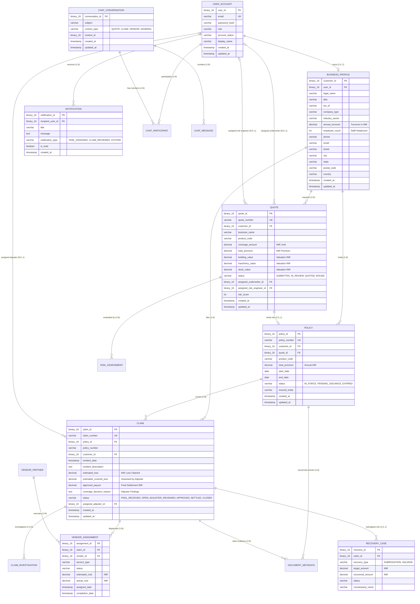
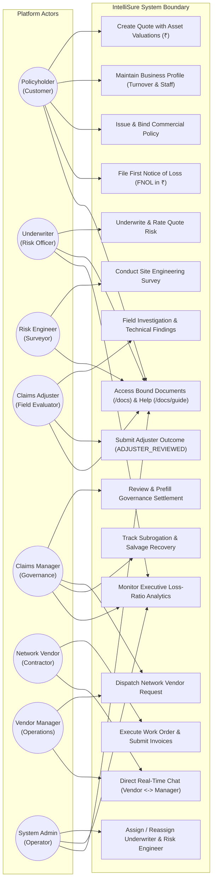
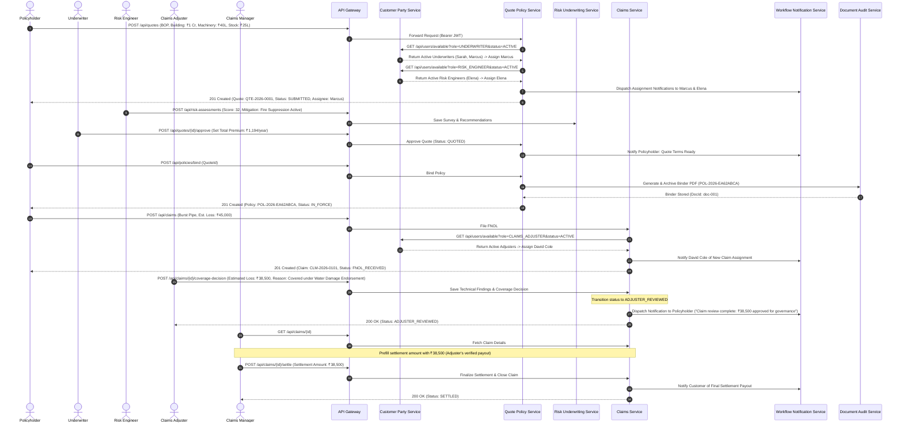

<style>
  body {
    font-family: -apple-system, BlinkMacSystemFont, "Segoe UI", Roboto, "Helvetica Neue", Arial, sans-serif;
    font-size: 11pt;
    line-height: 1.65;
    color: #1f2937;
    text-align: justify;
  }
  h1 { font-size: 26pt; font-weight: 800; color: #0f172a; text-align: left; border-bottom: 3px solid #75013f; padding-bottom: 12px; margin-top: 28pt; page-break-before: always; }
  h1.no-break { page-break-before: avoid; margin-top: 0; }
  h2 { font-size: 18pt; font-weight: 700; color: #75013f; text-align: left; border-bottom: 1px solid #cbd5e1; padding-bottom: 6px; margin-top: 22pt; page-break-after: avoid; }
  h3 { font-size: 13.5pt; font-weight: 600; color: #9a1750; text-align: left; margin-top: 16pt; page-break-after: avoid; }
  h4 { font-size: 11.5pt; font-weight: 600; color: #334155; text-align: left; margin-top: 12pt; page-break-after: avoid; }
  p, li { text-align: justify; }
  table { width: 100%; border-collapse: collapse; margin: 18px 0; page-break-inside: avoid; font-size: 9.5pt; }
  th, td { border: 1px solid #cbd5e1; padding: 9px 12px; vertical-align: top; }
  th { background-color: #f1f5f9; color: #0f172a; font-weight: 700; text-align: left; }
  tr:nth-child(even) { background-color: #f8fafc; }
  pre { background-color: #0f172a; color: #f8fafc; padding: 14px; border-radius: 6px; overflow-x: auto; font-size: 9pt; line-height: 1.45; page-break-inside: avoid; }
  code { font-family: "SFMono-Regular", Consolas, "Liberation Mono", Menlo, Courier, monospace; font-size: 9.5pt; background-color: #f1f5f9; padding: 2px 5px; border-radius: 4px; color: #0f172a; }
  pre code { background-color: transparent; padding: 0; color: inherit; font-size: inherit; }
  blockquote { border-left: 4px solid #75013f; padding: 10px 18px; background-color: #fdf8f9; color: #334155; margin: 18px 0; border-radius: 0 6px 6px 0; page-break-inside: avoid; }
  .badge { display: inline-block; padding: 2px 8px; font-size: 8.5pt; font-weight: 600; border-radius: 9999px; }
  .badge-get { background-color: #dbeafe; color: #1e40af; }
  .badge-post { background-color: #dcfce7; color: #15803d; }
  .badge-put { background-color: #fef3c7; color: #b45309; }
  .badge-patch { background-color: #f3e8ff; color: #6b21a8; }
  .badge-delete { background-color: #fee2e2; color: #b91c1c; }
  @page { margin: 20mm 18mm 20mm 18mm; size: A4; }
</style>

<h1 class="no-break">IntelliSure Enterprise Platform Specification</h1>

**Document Version:** 2.5.0  
**Target Environment:** Production / Multi-Cloud Enterprise  
**Architecture Classification:** Reactive Microservices & Federated Microfrontends  
**System Base Currency:** Indian Rupee (INR / ₹)  
**System Standard Timezone:** Indian Standard Time (IST / Asia/Kolkata, UTC+05:30)  
**Last Updated:** October 2026  
**Classification:** Confidential — Internal Technical & Business Architecture  

---

## 1. Abstract

The **IntelliSure** platform is a cloud-native, reactive commercial insurance management system designed to govern the entire commercial policyholder, carrier, adjuster, and vendor partner lifecycle. Commercial property and casualty insurance operations are traditionally hampered by siloed policy administration systems, manual underwriting handoffs, rigid claim adjudication queues, and fragmented third-party vendor coordination. IntelliSure addresses these systemic bottlenecks by implementing a decoupled, domain-driven microservices architecture backed by non-blocking reactive pipelines (Spring WebFlux, Project Reactor, R2DBC MySQL 8.4) and an enterprise Angular 17 Module Federation frontend.

The platform provides end-to-end lifecycle orchestration:
1. **Commercial Quoting & Property Valuation**: Dynamic multi-line commercial quoting with declared asset valuation schedules (Building Replacement Value, Machinery & Equipment, Inventory/Stock in INR ₹).
2. **Algorithmic Underwriter & Risk Engineer Assignment**: Automated workload-balanced assignment of active Underwriters and Risk Engineers from live database Single Source of Truth (SST), with full administrative reassignment capabilities.
3. **Engineering Site Surveys**: On-site structural inspections, risk score calculation, and mitigation hazard recommendations.
4. **Policy Issuance & Automated Binder Archival**: Policy binding, schedule generation, and caller-bound immutable document archival.
5. **Two-Stage Claims Adjudication**: FNOL (First Notice of Loss) ingestion, field investigation, technical assessment persistence (`ADJUSTER_REVIEWED`), automatic policyholder outcome notification, and Claims Manager governance settlement prefill.
6. **Network Vendor Dispatch & Direct Chat**: Dedicated vendor dispatch requests, role-safe work order execution, and direct real-time messaging between Network Vendors and Vendor Managers.
7. **Subrogation Recovery & Portfolio Intelligence**: Salvage liquidation, subrogation recovery ledgers, and real-time loss-ratio intelligence dashboards.

Security and regulatory compliance are guaranteed across all distributed boundaries via cryptographic JSON Web Tokens (JWT), role-based access control (RBAC), caller-bound data segregation, immutable audit logging, and automated end-to-end verification.

---

## 2. System Architecture & Microservices

IntelliSure follows a distributed, event-tolerant, reactive microservices architecture. High scalability, resilient fault isolation, and sub-100ms API response times are achieved through non-blocking asynchronous I/O across both the client-edge tier and the internal service mesh.

```mermaid
flowchart TB
    subgraph ClientTier ["Frontend Presentation Layer (Module Federation)"]
        Shell["Angular 17 Shell Application\n(Port 4200)"]
        AuthMFE["Auth MFE\n(Port 4201)"]
        ClaimsMFE["Claims MFE\n(Port 4202)"]
        IntelMFE["Intelligence MFE\n(Port 4203)"]
        VendorMFE["Vendor MFE\n(Port 4205)"]
        UICore["Shared UI-Core Library\n(Design System Primitives)"]
        
        Shell --> AuthMFE
        Shell --> ClaimsMFE
        Shell --> IntelMFE
        Shell --> VendorMFE
        Shell -.-> UICore
    end

    subgraph EdgeTier ["API Gateway & Discovery Layer"]
        Gateway["Spring Cloud Gateway\n(Port 8080)\n- Non-Blocking WebFlux\n- JWT Authentication & RBAC\n- Rate Limiting & Correlation ID"]
        Eureka["Netflix Eureka Server\n(Port 8761)\nDynamic Service Registry"]
    end

    subgraph ServiceMesh ["Reactive Microservices Tier (Spring WebFlux 4.1.1 / Java 17)"]
        CPS["Customer Party Service\n(Port 8081)\nUser Accounts & SST Employee Discovery"]
        QPS["Quote Policy Service\n(Port 8082)\nQuotes, Asset Valuation & Policies"]
        RUS["Risk Underwriting Service\n(Port 8083)\nSurveys, Hazard Scoring & Auto-Assignment"]
        CS["Claims Service\n(Port 8084)\nFNOL, Adjudication & Two-Stage Review"]
        VPS["Vendor Partner Service\n(Port 8085)\nOnboarding, Network & Work Orders"]
        RS["Recovery Service\n(Port 8086)\nSubrogation & Salvage Management"]
        WNS["Workflow Notification Service\n(Port 8087)\nReal-time Alerts & Peer-to-Peer Chat"]
        DAS["Document Audit Service\n(Port 8088)\nCaller-Bound Files & Immutable Audit Logs"]
        AIS["Analytics Intelligence Service\n(Port 8089)\nLoss Ratios & Portfolio Telemetry"]
    end

    subgraph PersistenceTier ["Database Persistence Layer (MySQL 8.4 / Non-Blocking R2DBC)"]
        DB1[(customer_party_db)]
        DB2[(quote_policy_db)]
        DB3[(risk_underwriting_db)]
        DB4[(claims_db)]
        DB5[(vendor_partner_db)]
        DB6[(recovery_continuity_db)]
        DB7[(workflow_notification_db)]
        DB8[(document_audit_db)]
        DB9[(analytics_intelligence_db)]
    end

    Shell ==>|HTTPS / WSS| Gateway
    Gateway -.->|Discovery Query| Eureka
    Gateway ==>|Reactive Routing + JWT| CPS
    Gateway ==>|Reactive Routing + JWT| QPS
    Gateway ==>|Reactive Routing + JWT| RUS
    Gateway ==>|Reactive Routing + JWT| CS
    Gateway ==>|Reactive Routing + JWT| VPS
    Gateway ==>|Reactive Routing + JWT| RS
    Gateway ==>|Reactive Routing + JWT| WNS
    Gateway ==>|Reactive Routing + JWT| DAS
    Gateway ==>|Reactive Routing + JWT| AIS

    CPS -.->|Register & Heartbeat| Eureka
    QPS -.->|Register & Heartbeat| Eureka
    RUS -.->|Register & Heartbeat| Eureka
    CS -.->|Register & Heartbeat| Eureka
    VPS -.->|Register & Heartbeat| Eureka
    RS -.->|Register & Heartbeat| Eureka
    WNS -.->|Register & Heartbeat| Eureka
    DAS -.->|Register & Heartbeat| Eureka
    AIS -.->|Register & Heartbeat| Eureka

    QPS ==>|WebClient: /api/users/available| CPS
    QPS ==>|WebClient: Notify Assignment| WNS
    CS ==>|WebClient: /api/users/available| CPS
    CS ==>|WebClient: Notify Outcome| WNS
    RUS ==>|WebClient: Notify Risk Assignment| WNS
    VPS ==>|WebClient: Notify Work Order| WNS
    DAS ==>|WebClient: Token Propagated Validation| QPS
    DAS ==>|WebClient: Token Propagated Validation| CS

    CPS --> DB1
    QPS --> DB2
    RUS --> DB3
    CS --> DB4
    VPS --> DB5
    RS --> DB6
    WNS --> DB7
    DAS --> DB8
    AIS --> DB9
```



### Microservices Catalog & Responsibilities

| Service Name | Port | Primary Responsibilities | Data Store | Key Outbound Dependencies |
|---|---|---|---|---|
| **api-gateway** | 8080 | Edge routing, JWT validation, correlation ID injection, rate limiting, CORS management. | None (Stateless) | All downstream services via Eureka |
| **eureka** | 8761 | Service discovery, peer health checking, dynamic instance registry. | Memory / In-cluster | None |
| **customer-party-service** | 8081 | Identity management, registration, commercial profiles with turnover and headcount, Single Source of Truth (SST) for active employee discovery. | MySQL 8.4 (`customer_party_db`) | Document Audit Service |
| **quote-policy-service** | 8082 | Commercial quote configuration, property asset valuations, algorithmic underwriter auto-assignment, binding, policy lifecycle. | MySQL 8.4 (`quote_policy_db`) | Customer Party, Workflow Notification |
| **risk-underwriting-service** | 8083 | Structural risk assessment, hazard scoring, site inspection order management, risk engineer assignment. | MySQL 8.4 (`risk_underwriting_db`) | Customer Party, Workflow Notification |
| **claims-service** | 8084 | FNOL ingestion, claim investigation, technical assessment persistence (`ADJUSTER_REVIEWED`), loss reserve allocation, governance prefill. | MySQL 8.4 (`claims_db`) | Customer Party, Quote Policy, Workflow Notification, Vendor Partner |
| **vendor-partner-service** | 8085 | Vendor network directory, contractor compliance onboarding, assignment dispatch, invoice tracking, role-safe vendor assignment access. | MySQL 8.4 (`vendor_partner_db`) | Claims Service, Workflow Notification |
| **recovery-service** | 8086 | Third-party subrogation recovery tracking, salvage liquidation, litigation ledger, dedicated vendor dispatch request. | MySQL 8.4 (`recovery_continuity_db`) | Claims Service, Vendor Partner |
| **workflow-notification-service** | 8087 | In-app alerts, dynamic task assignment notifications, peer-to-peer chat (including Vendor <-> Vendor Manager), IST timestamping. | MySQL 8.4 (`workflow_notification_db`) | Customer Party Service |
| **document-audit-service** | 8088 | Document metadata storage, binary retrieval, caller-bound security segregation, immutable system audit trail. | MySQL 8.4 (`document_audit_db`) / S3 | Quote Policy, Claims Service |
| **analytics-intelligence-service** | 8089 | Loss ratio calculation, exposure density, operational cycle times, executive reporting in INR (₹). | MySQL 8.4 (`analytics_intelligence_db`) | Read replicas / Events |

---

## 3. ER Diagram & Database Design

Each microservice encapsulates its own dedicated MySQL schema to maintain bounded-context isolation. Inter-service relationships are maintained via universally unique identifiers (`UUIDv4`).



---

## 4. UML Diagrams

### 4.1 Use Case Diagram



### 4.2 Class Diagram

```mermaid
classDiagram
    class UserAccount {
        +UUID userId
        +String email
        +String passwordHash
        +String role
        +String accountStatus
        +String displayName
        +LocalDateTime createdAt
    }

    class BusinessProfile {
        +UUID customerId
        +UUID userId
        +String legalName
        +BigDecimal annualTurnover
        +Integer employeeCount
        +String industrySector
    }

    class QuoteService {
        -QuoteRepository quoteRepository
        -UnderwriterAssignmentService assignmentService
        -WorkflowNotificationClient notificationClient
        -CustomerPartyClient customerPartyClient
        +Mono~QuoteResponse~ createQuote(CreateQuoteRequest req)
        +Flux~QuoteResponse~ getQuotesForCaller()
        +Mono~QuoteResponse~ reassignUnderwriter(UUID id, UUID underwriterId)
        +Mono~QuoteResponse~ reassignRiskEngineer(UUID id, UUID engineerId)
    }

    class RiskAssessmentService {
        -RiskAssessmentRepository repository
        -WorkflowNotificationClient notificationClient
        +Mono~RiskAssessmentResponse~ createAssessment(CreateAssessmentReq req)
        +Mono~RiskAssessmentResponse~ assignEngineer(UUID id, UUID engineerId)
    }

    class ClaimService {
        -ClaimRepository claimRepository
        -WorkflowNotificationClient notificationClient
        -SecurityActorService securityActorService
        +Flux~ClaimResponse~ getClaimsForCaller(UUID customerId, String status)
        +Mono~ClaimResponse~ fileClaim(FileClaimRequest req)
        +Mono~ClaimResponse~ recordAdjusterReview(UUID id, AdjusterReviewReq req)
        +Mono~ClaimResponse~ settleClaim(UUID id, SettleClaimReq req)
    }

    class ChatService {
        -ChatConversationRepository convRepo
        -ChatMessageRepository msgRepo
        +Flux~ChatMessageResponse~ getMessages(UUID conversationId)
        +Mono~ChatMessageResponse~ sendMessage(SendMessageRequest req)
        +Flux~ChatParticipantResponse~ getAvailableParticipants()
    }

    class SecurityActorService {
        +Mono~String~ currentRole()
        +Mono~UUID~ currentUserId()
        +Mono~UUID~ currentCustomerId()
        +Mono~Boolean~ hasAnyRole(String... roles)
    }

    QuoteService --> BusinessProfile
    QuoteService --> SecurityActorService
    ClaimService --> SecurityActorService
    RiskAssessmentService --> SecurityActorService
    ChatService --> SecurityActorService
```



### 4.3 Sequence Diagram: End-to-End Commercial Lifecycle



---

## 5. User Journey & Flow

```
┌─────────────────────────────────────────────────────────────────────────────────────────┐
│                                IntelliSure System Actors                                │
├─────────────────────┬─────────────────────────────────────┬─────────────────────────────┤
│      Customer       │         Internal Employees          │   Partners & Operations     │
├─────────────────────┼─────────────────────────────────────┼─────────────────────────────┤
│ • Policyholder      │ • Underwriter                       │ • Network Vendor            │
│                     │ • Risk Engineer                     │ • Vendor Manager            │
│                     │ • Claims Adjuster                   │ • System Administrator      │
│                     │ • Claims Manager                    │                             │
└─────────────────────┴─────────────────────────────────────┴─────────────────────────────┘
```

### 5.1 Journey Matrix by Actor

| Actor | Landing Page | Accessible Route Paths | Strict Access Control & UX Invariants |
|---|---|---|---|
| **`POLICYHOLDER`** | `/dashboard` | `/dashboard`, `/profile`, `/quotes`, `/quotes/new`, `/quotes/:id`, `/policy`, `/claims`, `/claims/new`, `/recovery`, `/docs`, `/notifications`, `/chat` | • **Can** manage legal business profile (Turnover ₹ & Headcount).<br/>• Declares asset valuations in `/quotes/new`.<br/>• Files FNOL claims with loss estimates in INR (₹).<br/>• Receives in-app notifications on adjuster review outcome (`ADJUSTER_REVIEWED`).<br/>• **Blocked** from `/admin`, `/underwriting`. |
| **`UNDERWRITER`** | `/underwriting` | `/underwriting`, `/quotes`, `/quotes/:id`, `/policy`, `/analytics`, `/docs`, `/notifications`, `/chat` | • Reviews assigned commercial quotes.<br/>• Views applicant business profile (turnover, staff, location) inside review workspace.<br/>• Evaluates property asset valuations and risk engineering scores.<br/>• Rates policies in INR (₹). |
| **`RISK_ENGINEER`** | `/quotes` | `/quotes`, `/quotes/:id`, `/underwriting`, `/docs`, `/notifications`, `/chat` | • **Zero 403 Access Denied** on landing or workspace entry.<br/>• Views active quote queue requiring engineering assessment.<br/>• Conducts property risk evaluations and submits structural risk scores.<br/>• Views applicant commercial business profile. |
| **`CLAIMS_ADJUSTER`** | `/claims` | `/claims`, `/claims/:id`, `/vendor`, `/docs`, `/notifications`, `/chat` | • Views assigned claims queue and linked policy contracts.<br/>• Submits technical investigation findings and coverage decisions.<br/>• Approves assessed payout, transitioning claim to `ADJUSTER_REVIEWED`.<br/>• Findings are persisted and never reset on page refresh. |
| **`CLAIMS_MANAGER`** | `/claims` | `/claims`, `/claims/:id`, `/vendor`, `/recovery`, `/analytics`, `/docs`, `/notifications`, `/chat` | • Inspects adjuster technical assessment and coverage decision findings.<br/>• Settlement amount form is **pre-filled** with the adjuster's assessed amount while remaining editable.<br/>• Executes governance approval and settlement payout in INR (₹).<br/>• Dispatches network vendor requests and manages subrogation. |
| **`VENDOR`** | `/vendor` | `/vendor`, `/vendor/assignments/:id`, `/chat` | • **Zero 403 errors** on `/api/vendor-assignments`.<br/>• Executes assigned restoration/repair work orders.<br/>• Initiates and participates in **direct real-time chat** with Vendor Managers. |
| **`VENDOR_MANAGER`** | `/vendor` | `/vendor`, `/vendor/assignments/:id`, `/recovery`, `/docs`, `/chat` | • Dispatches network vendor requests from recovery workspace.<br/>• Direct chat with network vendors.<br/>• Monitors vendor onboarding, licenses, and invoice completion. |
| **`ADMIN`** | `/admin` | `/admin`, `/quotes`, `/policy`, `/claims`, `/vendor`, `/analytics`, `/docs`, `/notifications`, `/chat` | • Reassigns Underwriters and Risk Engineers dynamically from live MySQL database records.<br/>• Full system oversight, audit event logs, and executive portfolio loss ratios. |

---

## 6. Functional Requirements & Business Rules

### 6.1 Core Functional Requirements (FR)

- **FR-01 (Dynamic Employee SST Discovery):** The platform shall dynamically retrieve active eligible employees for underwriting, risk engineering, claims adjustment, and vendor management directly from `customer-party-service` database records. Static application configuration files shall not be utilized.
- **FR-02 (Backend-Enforced Role Segregation):** All record filtering based on role status or user assignment shall be executed within backend R2DBC repository queries. Client-side filtering of sensitive domain data is strictly forbidden.
- **FR-03 (Draft Quote Isolation):** Customer quotes in `DRAFT` status shall only be visible to the customer who created them. Underwriters, Risk Engineers, and Administrators shall never receive draft quotes across any REST endpoint.
- **FR-04 (Algorithmic Workload Balancing & Assignment):** Quote auto-assignment shall query active workload counts for eligible underwriters and risk engineers, assigning the personnel possessing the lowest volume of active reviews. Admin users can manually assign or reassign personnel at any time.
- **FR-05 (Cross-Role Assignment Notifications):** Whenever an assignment or reassignment occurs (Quotes, Claims, Risk Surveys, Vendor Requests), instant in-app notifications shall be dispatched to both the assigned employee and the customer.
- **FR-06 (Currency Standard):** The platform operates strictly in **Indian Rupees (INR / ₹)** across all forms, tables, summary cards, and database records.
- **FR-07 (Timezone Standard):** All system timestamps, chat messages, notification logs, and audit trails shall be formatted and displayed in **Indian Standard Time (IST / Asia/Kolkata, UTC+05:30)**.
- **FR-08 (Property Asset Valuation):** The commercial quoting wizard shall collect declared asset replacement values for Building, Machinery & Equipment, and Inventory/Stock, feeding them directly into underwriting rating and risk scoring algorithms.
- **FR-09 (Commercial Business Profile Transparency):** Internal employees (Underwriters, Risk Engineers, Claims Adjusters, Claims Managers, Admin) shall have complete visibility of the customer's legal business name, annual turnover (₹), employee headcount, and operational category across quotes, policies, and claims.
- **FR-10 (Two-Stage Claim Adjudication):** Claim approval by a Claims Adjuster shall transition the claim to `ADJUSTER_REVIEWED` status and dispatch a formal notification to the policyholder. Claims Managers subsequently execute final governance settlement with a pre-filled, editable payout figure.
- **FR-11 (Adjuster Technical Findings Persistence):** Technical investigation assessments, estimated covered losses, and coverage decision reasons entered by Claims Adjusters shall be stored in the database and displayed persistently upon page refresh for all authorized personnel.
- **FR-12 (Universal Table Interactivity):** All data table rows across Quotes (`/quotes`), Policies (`/policy`), and Claims (`/claims`) shall be fully clickable, displaying pointer cursors and navigating directly to their corresponding detail view on click.
- **FR-13 (Vendor-Manager Direct Communication):** Certified Network Vendors and Vendor Managers shall be indexed in the platform chat directory and permitted to initiate direct real-time messaging conversations with one another.
- **FR-14 (Sidebar Help Center Accessibility):** The platform sidebar footer link (`? Help center`) shall navigate directly to the comprehensive user guide at `/docs/guide`.

### 6.2 Status State Machines

#### Quote Status Machine
```
[DRAFT] ──(Customer Submits)──> [SUBMITTED] ──(Assigned)──> [IN_REVIEW / RISK_ASSESSMENT]
                                                                        │
                                            ┌───────────────────────────┴───────────────────────────┐
                                            ▼                                                       ▼
                                         [QUOTED]                                               [DECLINED]
                                            │
                               (Customer Accepts / Binds)
                                            ▼
                                         [BOUND]
```

#### Claim Status Machine
```
[FNOL_RECEIVED] ──> [OPEN / COVERAGE_REVIEW] ──> [ADJUSTER_REVIEWED] ──> [APPROVED] ──> [SETTLED] ──> [CLOSED]
       │                                                 │                                                 ▲
       │                                                 └──(Notify Policyholder)                          │
       └─────────────────────────────(Disallow Transition from CLOSED)─────────────────────────────────────┘
```

---

## 7. API Documentation

### 7.1 Customer Party Service (`customer-party-service:8081`)

| Method | Endpoint | Allowed Roles | Request Payload | Success Status | Description |
|---|---|---|---|---|---|
| <span class="badge badge-post">POST</span> | `/api/auth/register` | `PUBLIC` | `RegisterRequest` | `201 CREATED` | Registers new customer or vendor applicant. |
| <span class="badge badge-post">POST</span> | `/api/auth/login` | `PUBLIC` | `LoginRequest` | `200 OK` | Authenticates credentials and issues signed JWT. |
| <span class="badge badge-get">GET</span> | `/api/users/me` | `AUTHENTICATED` | None | `200 OK` | Retrieves caller's account profile. |
| <span class="badge badge-get">GET</span> | `/api/users/available` | `AUTHENTICATED` | Query: `role`, `status` | `200 OK` | Queries active employees for dynamic assignment. |
| <span class="badge badge-get">GET</span> | `/api/customers/profile` | `AUTHENTICATED` | None | `200 OK` | Retrieves commercial profile (Turnover ₹ & Headcount). |
| <span class="badge badge-put">PUT</span> | `/api/customers/profile` | `POLICYHOLDER` | `CustomerProfileReq` | `200 OK` | Updates commercial turnover, staff count, and address. |

### 7.2 Quote Policy Service (`quote-policy-service:8082`)

| Method | Endpoint | Allowed Roles | Request Payload | Success Status | Description |
|---|---|---|---|---|---|
| <span class="badge badge-get">GET</span> | `/api/quotes` | `ALL_AUTHENTICATED` | None | `200 OK` | Retrieves pre-filtered quotes bound to caller role. |
| <span class="badge badge-post">POST</span> | `/api/quotes` | `POLICYHOLDER` | `CreateQuoteRequest` | `201 CREATED` | Creates quote with asset valuations & triggers auto-assignment. |
| <span class="badge badge-get">GET</span> | `/api/quotes/{id}` | `PARTIES_INVOLVED` | Path: `id` | `200 OK` | Retrieves quote, asset valuations, and review status. |
| <span class="badge badge-post">POST</span> | `/api/quotes/{id}/assign` | `ADMIN` | `AssignUnderwriterReq` | `200 OK` | Reassigns underwriter using live DB employee ID. |
| <span class="badge badge-get">GET</span> | `/api/policies` | `ALL_AUTHENTICATED` | None | `200 OK` | Lists active commercial policies. |
| <span class="badge badge-post">POST</span> | `/api/policies/bind` | `POLICYHOLDER` | `BindPolicyRequest` | `201 CREATED` | Binds accepted quote into in-force policy. |

### 7.3 Risk Underwriting Service (`risk-underwriting-service:8083`)

| Method | Endpoint | Allowed Roles | Request Payload | Success Status | Description |
|---|---|---|---|---|---|
| <span class="badge badge-get">GET</span> | `/api/risk-assessments/quote/{quoteId}` | `STAFF_ROLES` | Path: `quoteId` | `200 OK` | Retrieves structural risk survey and hazard score. |
| <span class="badge badge-post">POST</span> | `/api/risk-assessments` | `RISK_ENGINEER`, `UW` | `CreateRiskAssessmentReq` | `201 CREATED` | Submits property engineering survey & score. |
| <span class="badge badge-post">POST</span> | `/api/risk-assessments/{id}/assign` | `ADMIN` | `AssignEngineerReq` | `200 OK` | Reassigns technical risk engineer. |

### 7.4 Claims Service (`claims-service:8084`)

| Method | Endpoint | Allowed Roles | Request Payload | Success Status | Description |
|---|---|---|---|---|---|
| <span class="badge badge-get">GET</span> | `/api/claims` | `ALL_AUTHENTICATED` | Query: `status` (Optional) | `200 OK` | Lists claims filtered by caller identity. |
| <span class="badge badge-post">POST</span> | `/api/claims` | `POLICYHOLDER` | `FileClaimRequest` | `201 CREATED` | Submits FNOL claim with loss estimate in INR (₹). |
| <span class="badge badge-get">GET</span> | `/api/claims/{id}` | `PARTIES_INVOLVED` | Path: `id` | `200 OK` | Retrieves full claim, policy number, and adjuster findings. |
| <span class="badge badge-post">POST</span> | `/api/claims/{id}/coverage-decision` | `CLAIMS_ADJUSTER` | `CoverageDecisionReq` | `200 OK` | Submits adjuster assessment; transitions to `ADJUSTER_REVIEWED`. |
| <span class="badge badge-post">POST</span> | `/api/claims/{id}/settle` | `CLAIMS_MANAGER` | `SettleClaimReq` | `200 OK` | Finalizes governance settlement in INR (₹). |

### 7.5 Vendor Partner Service (`vendor-partner-service:8085`)

| Method | Endpoint | Allowed Roles | Request Payload | Success Status | Description |
|---|---|---|---|---|---|
| <span class="badge badge-get">GET</span> | `/api/vendors` | `STAFF_ROLES` | None | `200 OK` | Retrieves active vendor directory. |
| <span class="badge badge-get">GET</span> | `/api/vendor-assignments` | `STAFF_ROLES`, `VENDOR` | None | `200 OK` | Retrieves assignments (zero 403 for vendors). |
| <span class="badge badge-post">POST</span> | `/api/vendor-assignments` | `CLAIMS_ADJUSTER`, `CM` | `CreateAssignmentReq` | `201 CREATED` | Dispatches restoration work order. |

### 7.6 Workflow Notification & Chat Service (`workflow-notification-service:8087`)

| Method | Endpoint | Allowed Roles | Request Payload | Success Status | Description |
|---|---|---|---|---|---|
| <span class="badge badge-get">GET</span> | `/api/notifications` | `AUTHENTICATED` | None | `200 OK` | Retrieves caller's in-app notification stack. |
| <span class="badge badge-patch">PATCH</span> | `/api/notifications/{id}/read` | `AUTHENTICATED` | Path: `id` | `200 OK` | Marks notification as read. |
| <span class="badge badge-get">GET</span> | `/api/chat/conversations` | `AUTHENTICATED` | None | `200 OK` | Lists active chat threads sorted by recent message. |
| <span class="badge badge-post">POST</span> | `/api/chat/messages` | `AUTHENTICATED` | `SendMessageRequest` | `201 CREATED` | Sends message in IST with unread notification. |
| <span class="badge badge-get">GET</span> | `/api/chat/participants` | `AUTHENTICATED` | None | `200 OK` | Returns eligible chat directory (includes Vendors). |

---

## 8. Security & Role-Based Access

### 8.1 JSON Web Token (JWT) Specifications
The platform issues signed RS256/HS256 JWT tokens upon authentication via `customer-party-service`. Tokens encapsulate caller context, eliminating database lookups across downstream microservices:

```json
{
  "sub": "11111111-1111-1111-1111-111111111111",
  "email": "sarah.underwriter@intellisure.com",
  "roles": ["UNDERWRITER"],
  "userId": "11111111-1111-1111-1111-111111111111",
  "customerId": null,
  "displayName": "Sarah Jenkins",
  "iss": "intellisure-auth-service",
  "iat": 1791590400,
  "exp": 1791619200
}
```

### 8.2 Role-Based Access Control (RBAC) Matrix

| Resource / Endpoint | `POLICYHOLDER` | `UNDERWRITER` | `RISK_ENGINEER` | `CLAIMS_ADJUSTER` | `CLAIMS_MANAGER` | `VENDOR` | `VENDOR_MGR` | `ADMIN` |
|---|:---:|:---:|:---:|:---:|:---:|:---:|:---:|:---:|
| `/dashboard` | **ALLOW** | DENY | DENY | DENY | DENY | DENY | DENY | DENY |
| `/profile` (Profile Editor) | **ALLOW** | VIEW-ONLY | VIEW-ONLY | VIEW-ONLY | VIEW-ONLY | VIEW-ONLY | VIEW-ONLY | **ALLOW** |
| `/quotes/new` (Wizard) | **ALLOW** | DENY | DENY | DENY | DENY | DENY | DENY | DENY |
| `/quotes` (Quotes Queue) | **OWN ONLY** | **ASSIGNED** | **ALL ACTIVE** | VIEW | VIEW | DENY | DENY | **ALL (NO DRAFTS)** |
| `/underwriting` (Desk) | DENY | **ALLOW** | **ALLOW** | DENY | DENY | DENY | DENY | DENY |
| `/claims` (Claims Desk) | **OWN ONLY** | DENY | DENY | **ASSIGNED** | **ALL** | DENY | DENY | **ALL** |
| `/recovery` (Subrogation) | **OWN ONLY** | DENY | DENY | DENY | **ALLOW** | DENY | **ALLOW** | **ALLOW** |
| `/vendor` (Vendor Network) | DENY | DENY | DENY | **DISPATCH** | **ALLOW** | **WORK ORDERS**| **ALLOW** | **ALLOW** |
| `/docs` (Bound Documents) | **OWN** | **OWN** | **OWN** | **OWN** | **ALL** | **OWN** | **ALL** | **ALL** |
| `/docs/guide` (Help Center)| **ALLOW** | **ALLOW** | **ALLOW** | **ALLOW** | **ALLOW** | **ALLOW** | **ALLOW** | **ALLOW** |
| `/chat` (Peer Messaging) | **ALLOW** | **ALLOW** | **ALLOW** | **ALLOW** | **ALLOW** | **ALLOW** | **ALLOW** | **ALLOW** |
| `/admin` (System Ops) | DENY | DENY | DENY | DENY | DENY | DENY | DENY | **ALLOW** |
| `/analytics` (Metrics) | DENY | **ALLOW** | **ALLOW** | DENY | **ALLOW** | DENY | **ALLOW** | **ALLOW** |

---

## 9. Validation, DTOs & Exception Handling

### 9.1 Request Validation
Input schemas are enforced at the controller boundary using Jakarta Validation annotations on immutable Java records:

```java
public record CreateQuoteRequest(
    @NotBlank(message = "Business legal name is required")
    String businessName,

    @NotBlank(message = "Product line code is required")
    String productCode,

    @NotNull(message = "Coverage limit is required")
    @DecimalMin(value = "10000.00", message = "Minimum coverage limit is ₹10,000")
    BigDecimal coverageAmount,

    @DecimalMin(value = "0.00", message = "Building replacement value cannot be negative")
    BigDecimal buildingValue,

    @DecimalMin(value = "0.00", message = "Machinery value cannot be negative")
    BigDecimal machineryValue,

    @DecimalMin(value = "0.00", message = "Stock value cannot be negative")
    BigDecimal stockValue
) {}
```

### 9.2 RFC 7807 ProblemDetail Exception Handling
All microservices implement `@RestControllerAdvice` extending reactive error responses formatted according to standard RFC 7807 `ProblemDetail`:

```json
{
  "type": "https://api.intellisure.com/errors/access-denied",
  "title": "Access Denied",
  "status": 403,
  "detail": "Underwriters are not permitted to inspect or update customer commercial profiles.",
  "instance": "/api/customers/profile",
  "timestamp": "2026-10-12T01:15:00+05:30",
  "correlationId": "c8a1e2f9-42b7-49e0-8192-abcdef123456"
}
```

---

## 10. Technology Stack & Project Structure

### 10.1 Technology Inventory

| Layer | Technologies & Frameworks | Version / Specifications |
|---|---|---|
| **Frontend Framework** | Angular, RxJS, Zone.js | Angular 17.3, RxJS 7.8 |
| **Microfrontend Integration** | Module Federation, `ngx-build-plus` | `@angular-architects/module-federation` 17.0 |
| **State Management** | NgRx Store, Effects, Selectors, Entity | NgRx 17.2 |
| **Styling & UI Primitives** | Custom Design System, Tailwind CSS, UI-Core | Enterprise Claret (`#75013f`) & Neutral Design System |
| **Backend Runtime** | OpenJDK Java | Java 17 LTS |
| **Backend Framework** | Spring Boot, Spring WebFlux, Project Reactor | Spring Boot 4.1.1, Spring Cloud 2023.x |
| **Edge Routing & Discovery** | Spring Cloud Gateway, Netflix Eureka Server | Gateway Reactive, Eureka Client |
| **Database Engine** | MySQL Server 8.4 LTS | High-Performance InnoDB |
| **Database Connectivity** | Spring Data R2DBC, `r2dbc-mysql` Driver | Non-blocking reactive SQL driver |
| **Timezone & Localization** | Asia/Kolkata (IST), INR (`₹`) Currency | UTC+05:30 standardized |
| **Object Mapping & Boilerplate**| MapStruct, Project Lombok | MapStruct 1.5.5, Lombok 1.18 |
| **Unit & Integration Testing** | JUnit 5, Mockito, WebTestClient, Karma, Jasmine | JUnit Platform 6.0, Karma 6.4 |

### 10.2 Project Directory Structure

```
IntelliSure/
├── api-gateway/                      # Spring Cloud Gateway (Port 8080)
├── eureka/                           # Netflix Eureka Discovery (Port 8761)
├── customer-party-service/           # User accounts & employee SST (Port 8081)
├── quote-policy-service/             # Quotes, valuation & policies (Port 8082)
├── risk-underwriting-service/        # Surveys, scoring & engineering (Port 8083)
├── claims-service/                   # FNOL, investigations & two-stage review (Port 8084)
├── vendor-partner-service/           # Contractor directory & work orders (Port 8085)
├── recovery-service/                 # Subrogation & salvage management (Port 8086)
├── workflow-notification-service/    # Alert dispatch & peer chat (Port 8087)
├── document-audit-service/           # Bound documents & audit events (Port 8088)
├── analytics-intelligence-service/   # Loss ratios & executive telemetry (Port 8089)
├── docker-compose.yml                # Docker compose orchestration (12 containers)
├── Docs/                             # Architectural specifications & test guides
└── frontend/                         # Angular 17 Module Federation workspace
    ├── libs/
    │   ├── shared-models/            # Shared DTOs, interfaces & models
    │   └── ui-core/                  # Reusable canonical design system library
    ├── projects/
    │   ├── auth-mfe/                 # Authentication microfrontend (Port 4201)
    │   ├── claims-mfe/               # Claims adjudication microfrontend (Port 4202)
    │   ├── intelligence-mfe/         # Analytics & risk microfrontend (Port 4203)
    │   └── vendor-mfe/               # Vendor work order microfrontend (Port 4205)
    └── src/app/                      # Angular shell application (Port 4200)
```

---

## 11. Testing & Verification Standards

### 11.1 Backend Testing
Each Spring Boot service maintains automated tests covering business service methods, repository queries, and reactive controller pipelines:

```bash
# Build and execute unit tests for a specific microservice:
cd claims-service
./mvnw test

# Compile all backend services:
./build_all.ps1
```

### 11.2 Frontend Testing
The frontend workspace enforces unit and integration testing across shared libraries and microfrontends:

```bash
cd frontend

# Build shared design-system primitives:
npm run build:libs

# Test and verify shell & MFEs:
npm run test
npm run build
npm run build:claims
npm run build:vendor
npm run build:intelligence
npm run build:auth
```

---

## 12. Logging, Auditing & Timezone Standards

1. **Correlation ID Tracking**: The API Gateway generates or propagates an `X-Correlation-ID` HTTP header for every incoming request. Project Reactor’s subscriber context propagates this ID across downstream WebClient requests and logs it via SLF4J MDC.
2. **Structured Logging**: Logback formats logs as JSON containing `timestamp`, `level`, `service`, `correlationId`, `userId`, `thread`, and `message`.
3. **IST Timezone Standard**: Docker containers, Java Virtual Machines, MySQL connection pools, and frontend pipes configure `Asia/Kolkata` (`+05:30`), guaranteeing uniform timestamps across chat messages, notifications, and audit logs.
4. **Application Metrics**: Spring Boot Actuator endpoints (`/actuator/health`, `/actuator/prometheus`) expose JVM memory, garbage collection, and reactive thread pool statistics.

---

## 13. System Evolution & Roadmap

1. **Kafka Event Mesh**: Migration of synchronous WebClient notification hooks to an asynchronous Apache Kafka event backbone for horizontal event broadcasting.
2. **AI-Powered FNOL Damage Ingestion**: Multimodal computer vision models to automatically assess uploaded damage photos and predict preliminary loss reserves.
3. **Automated Subrogation Ledger**: Smart-contract or automated ACH subrogation settlement with third-party insurance carriers.
